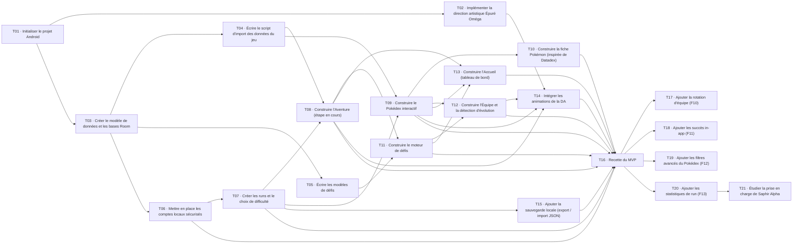

# Feuille de route et ordre d'exécution

Les tâches se traitent dans l'ordre `T01` → `T21`, une sous-tâche à la fois, et chaque milestone se termine par sa release `dev` → `main`. Une tâche ne commence que lorsque ses dépendances sont terminées. Le détail de chaque tâche est dans son issue GitHub.

## Ordre d'exécution

| Ordre | Tâche | Issue | Milestone | Priorité | Couche | Sous-tâches | Commence après |
| --- | --- | --- | --- | --- | --- | --- | --- |
| 1 | T01 · Initialiser le projet Android | #1 | M0 · Initialisation | P0 critique | backend | 5 | — |
| 2 | T02 · Implémenter la direction artistique Épuré Oméga | #7 | M0 · Initialisation | P1 haute | frontend | 3 | T01 (#1) |
| — | **[V0.1.0] Release v0.1.0 : fusionner dev dans main (M0)** | #88 | M0 · Initialisation | P1 haute | — | — | toutes les tâches du milestone |
| 3 | T03 · Créer le modèle de données et les bases Room | #11 | M1 · Données du jeu | P0 critique | backend | 4 | T01 (#1) |
| 4 | T04 · Écrire le script d'import des données du jeu | #16 | M1 · Données du jeu | P0 critique | backend | 6 | T03 (#11) |
| 5 | T05 · Écrire les modèles de défis | #23 | M1 · Données du jeu | P1 haute | backend | 3 | T03 (#11) |
| — | **[V0.2.0] Release v0.2.0 : fusionner dev dans main (M1)** | #89 | M1 · Données du jeu | P1 haute | — | — | toutes les tâches du milestone |
| 6 | T06 · Mettre en place les comptes locaux sécurisés | #27 | M2 · MVP | P0 critique | backend + frontend | 4 | T03 (#11) |
| 7 | T07 · Créer les runs et le choix de difficulté | #32 | M2 · MVP | P0 critique | frontend | 2 | T06 (#27) |
| 8 | T08 · Construire l'Aventure (étape en cours) | #35 | M2 · MVP | P0 critique | backend + frontend | 4 | T04 (#16), T07 (#32) |
| 9 | T09 · Construire le Pokédex interactif | #40 | M2 · MVP | P0 critique | backend + frontend | 4 | T04 (#16), T07 (#32) |
| 10 | T10 · Construire la fiche Pokémon (inspirée de Datadex) | #45 | M2 · MVP | P1 haute | frontend | 5 | T09 (#40) |
| 11 | T11 · Construire le moteur de défis | #51 | M2 · MVP | P0 critique | backend + frontend | 4 | T05 (#23), T08 (#35) |
| 12 | T12 · Construire l'Équipe et la détection d'évolution | #56 | M2 · MVP | P1 haute | backend + frontend | 3 | T09 (#40), T11 (#51) |
| 13 | T13 · Construire l'Accueil (tableau de bord) | #60 | M2 · MVP | P1 haute | frontend | 2 | T08 (#35), T09 (#40), T11 (#51) |
| 14 | T14 · Intégrer les animations de la DA | #63 | M2 · MVP | P2 moyenne | frontend | 4 | T02 (#7), T08 (#35), T09 (#40), T12 (#56) |
| 15 | T15 · Ajouter la sauvegarde locale (export / import JSON) | #68 | M2 · MVP | P1 haute | backend | 2 | T07 (#32) |
| 16 | T16 · Recette du MVP | #71 | M2 · MVP | P0 critique | backend | 3 | T06 (#27), T07 (#32), T08 (#35), T09 (#40), T10 (#45), T11 (#51), T12 (#56), T13 (#60), T14 (#63), T15 (#68) |
| — | **[V1.0.0] Release v1.0.0 : fusionner dev dans main (M2)** | #90 | M2 · MVP | P1 haute | — | — | toutes les tâches du milestone |
| 17 | T17 · Ajouter la rotation d'équipe (F10) | #75 | M3 · V2 | P2 moyenne | backend + frontend | 2 | T16 (#71) |
| 18 | T18 · Ajouter les succès in-app (F11) | #78 | M3 · V2 | P3 basse | backend + frontend | 2 | T16 (#71) |
| 19 | T19 · Ajouter les filtres avancés du Pokédex (F12) | #81 | M3 · V2 | P3 basse | backend + frontend | 2 | T16 (#71) |
| 20 | T20 · Ajouter les statistiques de run (F13) | #84 | M3 · V2 | P3 basse | backend + frontend | 2 | T16 (#71) |
| — | **[V1.1.0] Release v1.1.0 : fusionner dev dans main (M3)** | #91 | M3 · V2 | P1 haute | — | — | toutes les tâches du milestone |
| 21 | T21 · Étudier la prise en charge de Saphir Alpha | #87 | M4 · V3 (option) | P3 basse | backend | 0 | T20 (#84) |
| — | **[V2.0.0] Release v2.0.0 : fusionner dev dans main (M4)** | #92 | M4 · V3 (option) | P1 haute | — | — | toutes les tâches du milestone |

## Dépendances entre tâches

## Vues par priorité

### P0 critique

- #1 T01 · Initialiser le projet Android (M0 · Initialisation)
- #11 T03 · Créer le modèle de données et les bases Room (M1 · Données du jeu)
- #16 T04 · Écrire le script d'import des données du jeu (M1 · Données du jeu)
- #27 T06 · Mettre en place les comptes locaux sécurisés (M2 · MVP)
- #32 T07 · Créer les runs et le choix de difficulté (M2 · MVP)
- #35 T08 · Construire l'Aventure (étape en cours) (M2 · MVP)
- #40 T09 · Construire le Pokédex interactif (M2 · MVP)
- #51 T11 · Construire le moteur de défis (M2 · MVP)
- #71 T16 · Recette du MVP (M2 · MVP)

### P1 haute

- #7 T02 · Implémenter la direction artistique Épuré Oméga (M0 · Initialisation)
- #23 T05 · Écrire les modèles de défis (M1 · Données du jeu)
- #45 T10 · Construire la fiche Pokémon (inspirée de Datadex) (M2 · MVP)
- #56 T12 · Construire l'Équipe et la détection d'évolution (M2 · MVP)
- #60 T13 · Construire l'Accueil (tableau de bord) (M2 · MVP)
- #68 T15 · Ajouter la sauvegarde locale (export / import JSON) (M2 · MVP)

### P2 moyenne

- #63 T14 · Intégrer les animations de la DA (M2 · MVP)
- #75 T17 · Ajouter la rotation d'équipe (F10) (M3 · V2)

### P3 basse

- #78 T18 · Ajouter les succès in-app (F11) (M3 · V2)
- #81 T19 · Ajouter les filtres avancés du Pokédex (F12) (M3 · V2)
- #84 T20 · Ajouter les statistiques de run (F13) (M3 · V2)
- #87 T21 · Étudier la prise en charge de Saphir Alpha (M4 · V3 (option))

## Sous-tâches dans l'ordre

### T01 · Initialiser le projet Android (#1)

1. #2 T01.1 · Créer le projet Kotlin / Jetpack Compose · taille S · `dev-backend`
2. #3 T01.2 · Mettre en place l'architecture en couches et Hilt · taille M · `dev-backend`
3. #4 T01.3 · Configurer la qualité du code (ktlint, detekt, .editorconfig) · taille S · `dev-backend`
4. #5 T01.4 · Ajouter la CI GitHub Actions (build, lint, tests) · taille S · `dev-backend`
5. #6 T01.5 · Documenter le lancement sur émulateur · taille S · `dev-backend`

### T02 · Implémenter la direction artistique Épuré Oméga (#7)

1. #8 T02.1 · Créer le thème Compose (couleurs, typographies, formes) · taille S · `dev-frontend`
2. #9 T02.2 · Créer les composants de base de la DA · taille M · `dev-frontend`
3. #10 T02.3 · Créer les icônes Ω et gemme et la barre de navigation · taille S · `dev-frontend`

### T03 · Créer le modèle de données et les bases Room (#11)

1. #12 T03.1 · Créer les entités de la base jeu · taille M · `dev-backend`
2. #13 T03.2 · Créer les entités de la base progression · taille M · `dev-backend`
3. #14 T03.3 · Créer les DAO, repositories et migrations · taille M · `dev-backend`
4. #15 T03.4 · Embarquer la base jeu pré-remplie · taille S · `dev-backend`

### T04 · Écrire le script d'import des données du jeu (#16)

1. #17 T04.1 · Importer espèces, types, talents et évolutions · taille M · `dev-backend`
2. #18 T04.2 · Importer attaques et apprentissages (version Rubis Oméga) · taille M · `dev-backend`
3. #19 T04.3 · Importer lieux, zones annexes et rencontres · taille L · `dev-backend`
4. #20 T04.4 · Importer les 13 étapes, quêtes et équipes des champions · taille M · `dev-backend`
5. #21 T04.5 · Vérifier les données étape par étape · taille M · `dev-backend`
6. #22 T04.6 · Générer et versionner la base SQLite · taille S · `dev-backend`

### T05 · Écrire les modèles de défis (#23)

1. #24 T05.1 · Définir le format des modèles de défis · taille S · `dev-backend`
2. #25 T05.2 · Rédiger les défis des 13 étapes · taille M · `dev-backend`
3. #26 T05.3 · Définir la règle Hardcore et les règles du plafond · taille S · `dev-backend`

### T06 · Mettre en place les comptes locaux sécurisés (#27)

1. #28 T06.1 · Créer l'inscription et la connexion · taille M · `dev-frontend`
2. #29 T06.2 · Gérer la session et le changement de joueur · taille S · `dev-backend`
3. #30 T06.3 · Chiffrer la base progression et isoler les comptes · taille M · `dev-backend`
4. #31 T06.4 · Tester la sécurité des comptes · taille S · `dev-backend`

### T07 · Créer les runs et le choix de difficulté (#32)

1. #33 T07.1 · Créer l'écran de création de run · taille S · `dev-frontend`
2. #34 T07.2 · Lister et changer de run · taille S · `dev-frontend`

### T08 · Construire l'Aventure (étape en cours) (#35)

1. #36 T08.1 · Créer l'écran de l'étape en cours · taille M · `dev-frontend`
2. #37 T08.2 · Cocher les quêtes principales et annexes · taille S · `dev-frontend`
3. #38 T08.3 · Déverrouiller l'étape suivante · taille M · `dev-backend`
4. #39 T08.4 · Créer la fiche de lieu · taille S · `dev-frontend`

### T09 · Construire le Pokédex interactif (#40)

1. #41 T09.1 · Créer la grille du Pokédex · taille M · `dev-frontend`
2. #42 T09.2 · Gérer les statuts d'entraînement · taille S · `dev-frontend`
3. #43 T09.3 · Ajouter recherche et filtres simples · taille S · `dev-frontend`
4. #44 T09.4 · Débloquer le Pokédex national après la Ligue · taille S · `dev-backend`

### T10 · Construire la fiche Pokémon (inspirée de Datadex) (#45)

1. #46 T10.1 · Créer la structure de la fiche en 6 onglets · taille S · `dev-frontend`
2. #47 T10.2 · Créer les onglets Infos et Stats · taille S · `dev-frontend`
3. #48 T10.3 · Créer l'onglet Évolution · taille S · `dev-frontend`
4. #49 T10.4 · Créer l'onglet Attaques · taille M · `dev-frontend`
5. #50 T10.5 · Créer les onglets Lieux et Défis · taille S · `dev-frontend`

### T11 · Construire le moteur de défis (#51)

1. #52 T11.1 · Générer les défis selon difficulté et plafond · taille M · `dev-backend`
2. #53 T11.2 · Valider, retenter et historiser les défis · taille S · `dev-backend`
3. #54 T11.3 · Créer l'espace Défis et la page Défis par Pokémon · taille M · `dev-frontend`
4. #55 T11.4 · Tester le moteur de défis · taille S · `dev-backend`

### T12 · Construire l'Équipe et la détection d'évolution (#56)

1. #57 T12.1 · Créer l'écran Équipe · taille S · `dev-frontend`
2. #58 T12.2 · Ajouter et échanger des membres · taille S · `dev-frontend`
3. #59 T12.3 · Détecter la condition d'évolution · taille S · `dev-backend`

### T13 · Construire l'Accueil (tableau de bord) (#60)

1. #61 T13.1 · Créer les jauges aventure, Pokédex et défis · taille S · `dev-frontend`
2. #62 T13.2 · Afficher l'étape en cours et le défi du jour · taille S · `dev-frontend`

### T14 · Intégrer les animations de la DA (#63)

1. #64 T14.1 · Animer la validation d'étape · taille M · `dev-frontend`
2. #65 T14.2 · Animer la capture qui remplit le Pokédex · taille M · `dev-frontend`
3. #66 T14.3 · Animer l'évolution plein écran · taille L · `dev-frontend`
4. #67 T14.4 · Respecter la réduction des animations · taille S · `dev-frontend`

### T15 · Ajouter la sauvegarde locale (export / import JSON) (#68)

1. #69 T15.1 · Exporter la progression d'un compte · taille S · `dev-backend`
2. #70 T15.2 · Importer et contrôler une sauvegarde · taille S · `dev-backend`

### T16 · Recette du MVP (#71)

1. #72 T16.1 · Vérifier les critères d'acceptation · taille S · `dev-backend`
2. #73 T16.2 · Tester sur les 3 profils d'émulateur et en mode avion · taille S · `dev-backend`
3. #74 T16.3 · Faire une run test jusqu'à la Ligue · taille M · `dev-backend`

### T17 · Ajouter la rotation d'équipe (F10) (#75)

1. #76 T17.1 · Calculer les suggestions de rotation · taille S · `dev-backend`
2. #77 T17.2 · Afficher les suggestions dans l'Équipe · taille S · `dev-frontend`

### T18 · Ajouter les succès in-app (F11) (#78)

1. #79 T18.1 · Définir et détecter les succès · taille S · `dev-backend`
2. #80 T18.2 · Afficher les succès · taille S · `dev-frontend`

### T19 · Ajouter les filtres avancés du Pokédex (F12) (#81)

1. #82 T19.1 · Ajouter les filtres zone et méthode · taille S · `dev-backend`
2. #83 T19.2 · Combiner et mémoriser les filtres · taille S · `dev-frontend`

### T20 · Ajouter les statistiques de run (F13) (#84)

1. #85 T20.1 · Calculer les statistiques · taille S · `dev-backend`
2. #86 T20.2 · Créer l'écran Statistiques · taille S · `dev-frontend`
